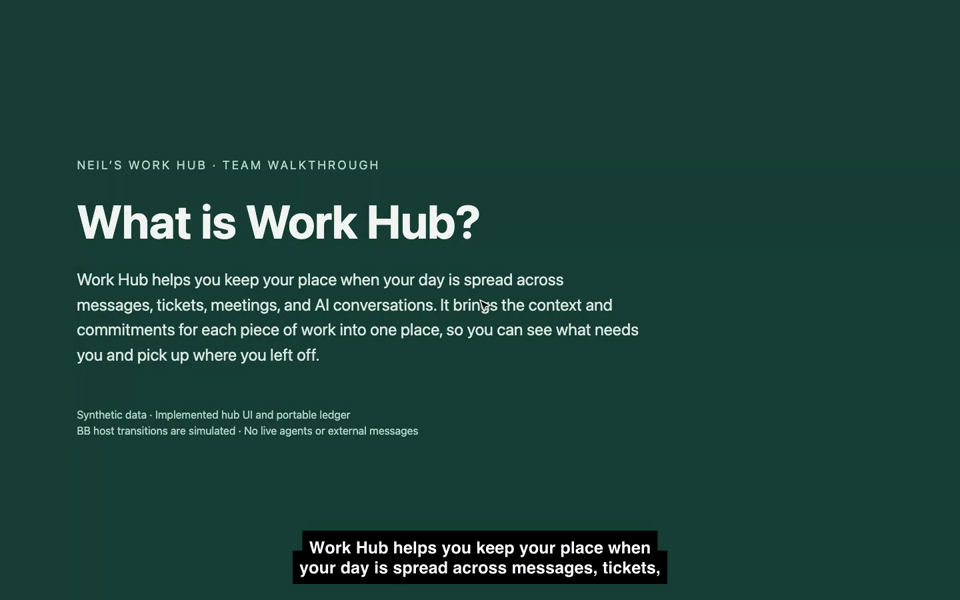
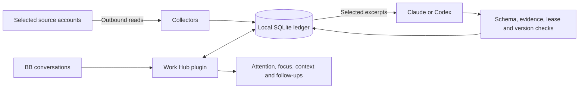
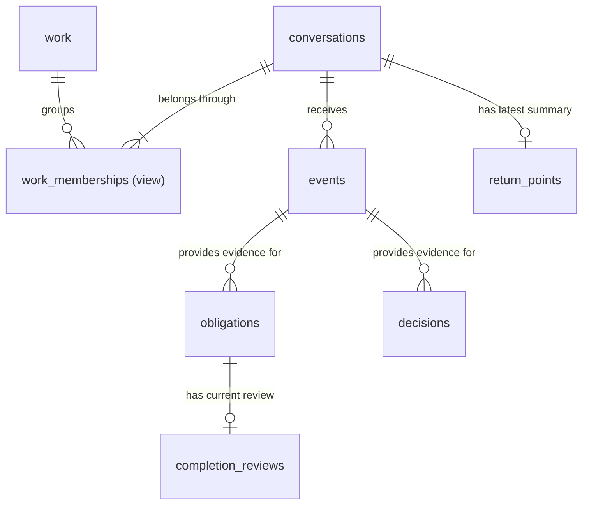

# Work Hub

Keep your place across parallel work, AI conversations, and incoming requests.

Work Hub brings related conversations, source evidence, next actions and follow-ups into a local work register inside [BB](https://getbb.app/). Focus several work items, see important arrivals, resume a conversation, or start a related agent with the context already assembled.

**Start here:** [Introduction and videos](docs/videos/README.md) · [Complete setup guide](SETUP.md) · [Copy/paste AI setup prompt](SETUP-PROMPT.md) · [Security and privacy](SECURITY.md)

## Watch the introduction

[](docs/videos/overview.mp4)

Start with the 77-second overview, then explore [nine short workflow walkthroughs](docs/videos/README.md). Every video includes clean narration, captions and a transcript.

## What it does

- Connects BB conversations across models without moving or replacing their transcripts.
- Focusing a work item pins its linked, unarchived BB threads. You can manage those pins in BB after removing focus.
- Tracks what you owe and what others owe you, with source evidence and shared status.
- Keeps user-chosen next actions separate from model suggestions.
- Reads selected Google, Slack, Linear, GitHub, Granola and Better Stack sources.
- Supports full-screen, portrait-monitor and narrow-sidebar layouts.
- Opens linked PRs/issues in BB's sidebar and provides related context inside threads.

[Automatic context and completion review](docs/work-lifecycle.md) connects new conversations to their sources and checks whether commitments are already fulfilled.

## Daily workflow skills

The plugin includes `work-hub`, `work-hub-plan`, `work-hub-resume`, `work-hub-follow-up`, `work-hub-checkpoint`, and `work-hub-review-completion`. Ask your AI to plan the day, resume work, review commitments, or save a return point. They use your configured Work Hub and work across BB providers; no personal orchestration skill is needed. See [skill usage and limits](docs/skills.md).

## Architecture



Configuration and OAuth credentials default to BB’s encrypted Env Catalog, with environment-variable and JSON-file overrides. See [storage and migration](docs/storage.md). The ledger stays in local SQLite.

Python owns the ledger and collectors; a TypeScript plugin supplies the BB interface. Background analysis can use Claude Code or Codex independently of interactive BB model choices. A Claude-only user does not need Codex.

## Data model

A **work item** groups related conversations and source records around an outcome. A conversation can belong to several work items; its commitments and decisions are shared across them without duplicate records. Each commitment has one status.



These are SQLite names: **`work_memberships` is a view** combining each conversation's primary work with additional links; the other boxes are tables. Lines describe application relationships, not declared SQL foreign keys. A crow's foot means “many”; a circle allows zero.

- **Events preserve provenance:** versioned source excerpts, source/receipt times, and analysis state. Commitments (`obligations`) and accepted decisions point back to an event and its quoted evidence.
- **Return points preserve context:** `return_points` holds the latest asynchronous model summary and suggested next action per conversation. Immediate agent handoffs and your chosen next action live separately as JSON records in `meta`; an agent report does not prove completion.
- **Context and completion have their own lifecycle:** source references connect related evidence, context requests track pending reads, and completion reviews retain assessments and an audit history. Marking an arrival seen or a work item done does not fulfill its commitments.

See the [detailed data model](docs/data-model.md) for membership storage, JSON metadata, review evidence and a synthetic example. Configuration and credentials use a [separate storage layer](docs/storage.md).

## Status and boundaries

Experimental, single-user, local-first software. The documented background setup targets macOS and requires the computer to be awake and logged in. No public laptop ports or cloud workers are needed. Model analysis sends selected source excerpts to the chosen provider; it is not local inference.

Collection defaults to off. You choose accounts, sources and the analyzer before enabling it. Coverage is bounded, extraction is asynchronous and commitments can need review. Check source freshness and backlog before relying on an empty attention panel.

Automatic live PR-review/error-fixer workers are not included. Starting an agent uses BB's native composer and the permissions you choose there.

## Development checks

Install dependencies using SETUP.md, then run:

```bash
.venv/bin/python -m unittest discover -s hub -p 'test_*.py'
.venv/bin/python -m unittest discover -s connectors/google -p 'test_*.py'
node --experimental-strip-types --test bb-plugin-work-hub/reference-links.test.ts bb-plugin-work-hub/launch-context.test.ts bb-plugin-work-hub/context-hook.test.ts bb-plugin-work-hub/handoff-hook.test.ts
./bb-plugin-work-hub/node_modules/.bin/tsc --noEmit -p bb-plugin-work-hub/tsconfig.json
bb plugin build ./bb-plugin-work-hub
```

See [the security review](docs/security-review.md) for audit scope and limitations. Do not contribute private state, credentials, source excerpts or machine-specific settings. No open-source license has been selected yet; public visibility does not itself grant a software license.
