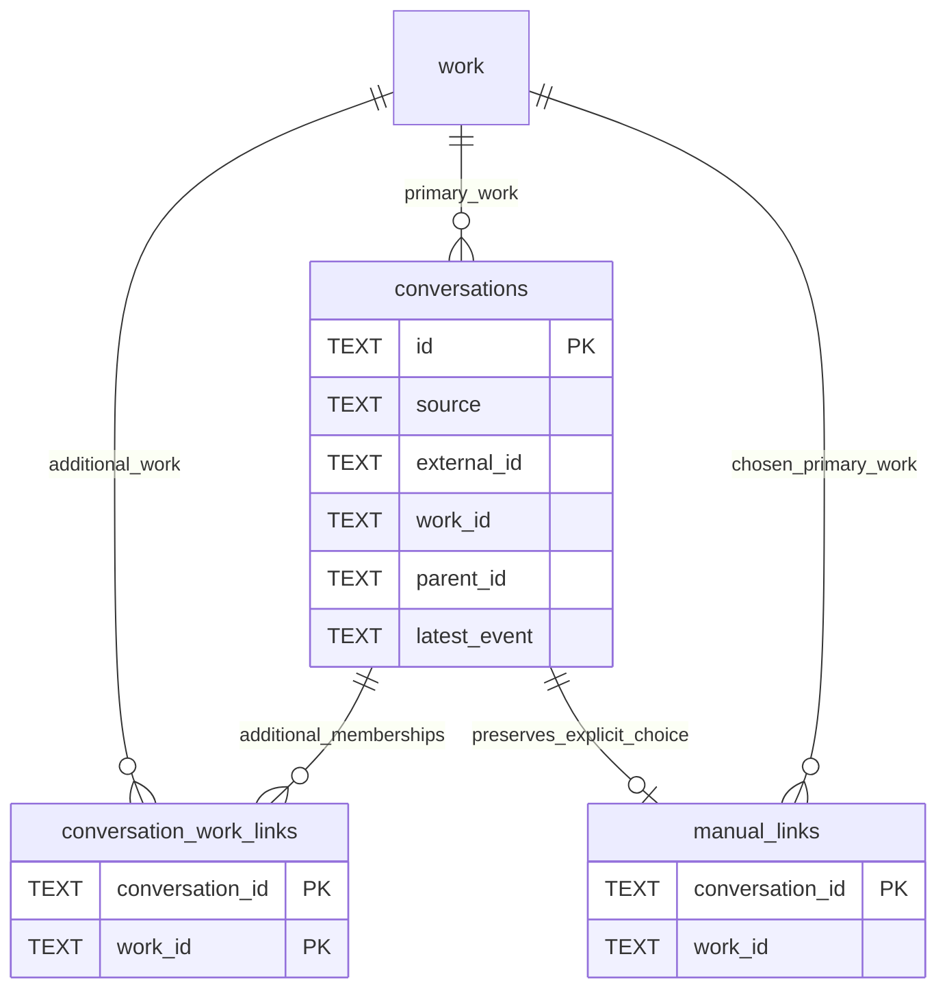
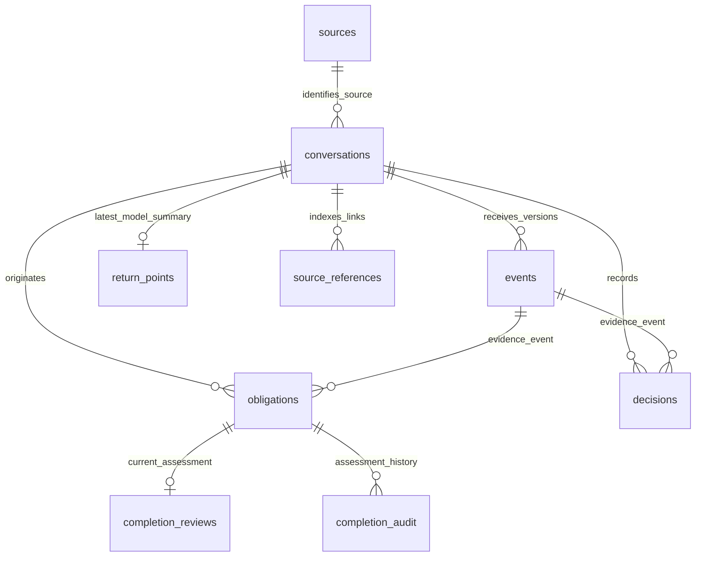

# Work Hub data model

Work Hub stores its work register in a local SQLite ledger. A work item is an outcome to resume; a conversation is a captured BB thread or external source record. Related conversations can share several work items without copying their commitments or decisions. Original transcripts remain in their source systems; the ledger holds bounded, versioned excerpts and links.

This reference describes storage implemented in [store.py](../hub/store.py), [lifecycle.py](../hub/lifecycle.py), [presentation.py](../hub/presentation.py), [handoffs.py](../hub/handoffs.py) and [tracking.py](../hub/tracking.py). Configuration and credentials are outside the ledger's `meta` table; see [storage boundaries](storage.md) and [security and privacy](../SECURITY.md).

## Work and conversation memberships



Boxes above are **physical tables**. Relationships describe application invariants: the schema declares primary keys, uniqueness and some check constraints, but no SQL `FOREIGN KEY` clauses. `PK` on both link columns denotes a composite primary key.

Every conversation has one primary `conversations.work_id`. Additional associations live in `conversation_work_links`. The **SQL view** `work_memberships` combines both:

```sql
SELECT id AS conversation_id, work_id FROM conversations
UNION
SELECT conversation_id, work_id FROM conversation_work_links;
```

`UNION` removes duplicate pairs. The view is derived, not a separately stored or exported table. Work detail queries join through it to show conversations, obligations and decisions across all memberships. `obligations.work_id` retains the primary work; the displayed `work_ids` list is derived from the obligation's conversation memberships.

`manual_links` preserves explicit primary-work choices against automatic grouping. Removing a primary association promotes a remaining one and updates the obligation's primary work. The application refuses to remove a conversation's last membership. `parent_id` can connect a child conversation to its parent for grouping; it is separate from the many-to-many membership relationship and can arrive before the parent is captured.

## Evidence and completion



All boxes in this diagram are **physical tables**. The model uses these identities and evidence fields:

| Record | Identity and role |
|---|---|
| `sources` | One row per source name; connection/coverage state, collection checkpoint, check and success times, and errors. A source row is not an account credential. |
| `conversations` | Unique `(source, external_id)`; title, source URL, model, primary work and latest event pointer. Registration can precede receipt of any event. |
| `events` | Unique `(conversation_id, version)`; captured text, `occurred_at`, `received_at`, and analysis retry/lease state. The latest pointer selects current evidence; earlier versions remain stored. |
| `obligations` | A commitment with owner, direction (`i_owe`, `they_owe`, `unclear`), optional due time, state, resolution and version. `conversation_id`, `evidence_event` and `evidence_quote` retain its source attribution. |
| `decisions` | Accepted decision text with originating conversation, `evidence_event` and exact `quote`. These rows supply work-detail decisions; `work.decisions` is a JSON summary cache, not a second decision ledger. |
| `return_points` | One latest asynchronous model summary and suggested `next_action` per conversation, with its update time. This table is overwritten on successful analysis, not an append-only history. |
| `completion_reviews` | At most one current queue/assessment row per obligation: state, lease, assessed obligation version, evidence fingerprint, verdict, reason, citations and applied version. |
| `completion_audit` | Assessment history: obligation, assessed version, verdict, reason, citations and check time. It records reviews, not every obligation edit. |
| `source_references` | Composite key `(key, conversation_id)` with canonical URL and source. Rebuilt from the conversation URL and latest captured text; the same reference key can connect several conversations. |

Extraction checks decision and obligation quotes against the cited event text. It also checks the analysis lease and latest source version before applying results. Model-extracted resolutions retain the resolving quote; repeated extraction must not reopen a fulfilled or cancelled commitment.

Completion review gathers bounded current evidence from the originating conversation, shared work memberships and matching source references. Its `evidence` column is a JSON array of citations containing `event_id`, URL, exact quote and occurrence time. These are logical event references inside JSON, not a separate citation table. [completion.py](../hub/completion.py) validates the model's quotes and confidence; lifecycle methods check obligation versions and evidence freshness before applying a confirmed assessment. Review policy and limits are described in [the lifecycle guide](work-lifecycle.md).

## Context requests

`context_requests` is a **physical table**, keyed by `(thread_id, reference_key)`. It stores the requested URL, pending/running/ready/error state, retry timing and lease information. `thread_id` is the external BB thread identifier, not `conversations.id`; `reference_key` uses the same canonical identity as `source_references.key`.

A request can exist before the referenced source conversation has been fetched. Successful reads attach the source conversation to the requesting thread's work, preserving existing manual choices and using additional memberships when needed. Targeted reads do not advance scheduled collection checkpoints. The reference index and request queue are therefore related by canonical identity, not by a required one-to-one row link. See [references.py](../hub/references.py) for normalization and [source_reads.py](../hub/source_reads.py) for bounded reads.

## JSON metadata and separate kinds of state

`meta` is a **physical key/value table** (`key TEXT PRIMARY KEY`, `value TEXT`). The records below are JSON serialized into `value`; they are **not SQL tables or views**. Other operational keys can contain scalar text.

| Key pattern | Stored meaning |
|---|---|
| `intent:<work_id>` | User-chosen next action, purpose, project label and optional resume thread, with version and update time. Model summaries do not overwrite this intent. |
| `checkpoint:<conversation_id>` | Event ID and occurrence, receipt and analysis times for the last applied analysis; ties the model return point to its source version. |
| `handoff:<conversation_id>` | Current agent-reported status, progress, remaining work, next action, blocker, evidence links, report/turn times and origin, plus up to five previous snapshots. Separate from the asynchronous `return_points` table. |
| `day_plan:<date>` | Ordered work IDs, note, version and timestamp for a local calendar day. |
| `attention_seen:<token>` | Acknowledgment time for a meaningful attention-item fingerprint. |
| `change_seen:<seq>` | Acknowledgment time for one change-feed entry. `last_seen_seq` is a separate scalar watermark. |
| `context_candidates:<thread_id>` | Alternative work IDs found while linking a BB thread. |
| `prior_context:<thread_id>` | Prior work IDs excluded from a new repeat request because earlier obligations were resolved. |
| `context_project:<thread_id>` | BB project identifier saved with the thread context. |
| `completion_basis:<obligation_id>` | Event IDs used to check that evidence has not changed before applying a review. |
| `tracking_teams` | Explicitly configured Linear team keys whose issues serve as reference-only tracking archives. Defaults to an empty list. |
| `tracking_keep:<obligation_id>` | Boolean marker retaining a legacy commitment for ordinary active follow-up after reconciliation. |

Work `status` (`active`, `waiting`, `done`), focus, chosen intent, attention acknowledgment and obligation state (`open`, `needs_review`, `fulfilled`, `cancelled`) are separate. Seeing an item does not resolve it. A work item can be done while a commitment remains open; the attention model exposes that mismatch.

### Immediate handoffs

A handoff is an immediate resumption aid, saved either as a structured agent report (`origin: agent`) or from captured BB turn state/output (`origin: capture`). It retains report time (`at`) and turn time (`turn_at`); older reports cannot replace newer ones. Structured reports distinguish paused, blocked, needs-input and ready-for-review states; captured state can also record active or failed turns. A final captured output can preserve an existing structured report for the same turn.

Handoff evidence is a list of reported links, not validated completion citations. Neither a handoff nor its bounded history changes obligation state. The selected work's context packet and conversation details expose these records alongside source evidence and model return points.

### Legacy tracking reconciliation

Tracking roles are derived from the configured team keys and a Linear conversation's external issue identifier; there is no tracking-role SQL table. For configured teams, new events are stored as `reference_only` and skip fresh extraction. Existing obligations remain in their original rows with their evidence and states preserved.

The paginated reconciliation view is an application query, **not a SQL view**. It exposes open/needs-review legacy obligations that have not been explicitly retained. Those obligations are omitted from ordinary attention/reminders pending reconciliation; a version-checked keep action writes `tracking_keep:<obligation_id>` without duplicating the obligation. Existing source records and memberships remain available as context. This policy does not itself modify external Linear issues.

## Supporting tables and portability

| Physical table | Purpose |
|---|---|
| `work` | Title, status, focus and latest model-derived summary/next action, plus the JSON decision summary cache. |
| `changes` | Ordered local change feed (`seq`, kind, entity ID, detail, time). Entity IDs are interpreted by kind, not constrained to one table. |
| `jobs`, `job_leases` | Revision-keyed job records and current ownership leases. Their existence does not enable unattended coding workers. |
| `reminders`, `reminder_items` | Delivery batches and obligation/due-date/day deduplication. Reminder delivery state is separate from fulfillment. |
| `meta` | Portable intent, presentation, context and operational records described above. |

Ledger export schema 3 includes all 19 application tables, including `meta` and completion history. `work_memberships` is recreated from schema. Imports support earlier export versions, require an empty destination and reset interrupted work conservatively. Credentials are not part of the export. Exported source excerpts and evidence are private; use the [setup guide's backup instructions](../SETUP.md#9-backup-stop-and-troubleshoot).

## Synthetic example

Suppose **Release checklist** and **Help guide** are two work items. A single **Review copy** conversation belongs primarily to Release checklist and has an additional membership in Help guide. Its captured event contains the fictional promise “I will review the introduction.” Extraction creates one obligation citing that event and quote.

Both work items display the same obligation and accepted decisions. Updating the obligation changes it in both places. A chosen next action belongs to each work item, while the conversation's model return point belongs to the conversation. A later completion review can cite newer source evidence and retain the assessment in `completion_audit`; simply marking either work item done does not fulfill the promise.
