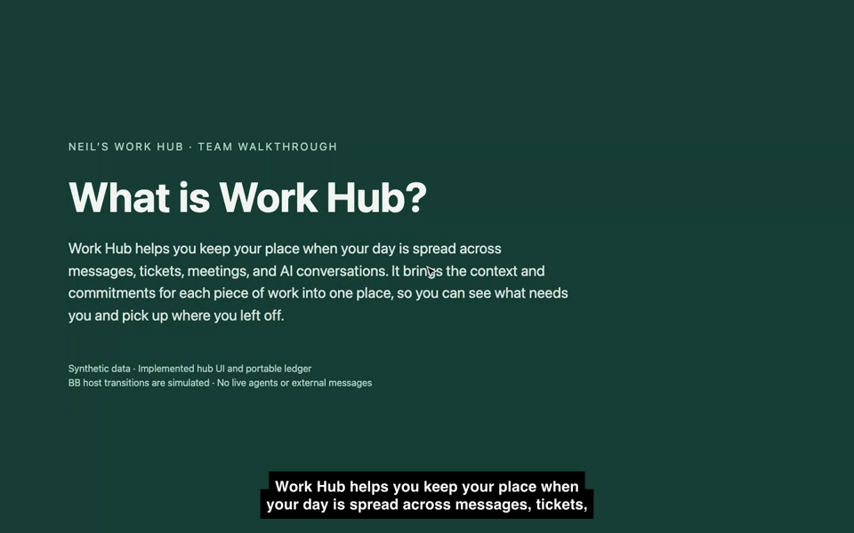

# Introduction and walkthrough videos

Start with **[What is Work Hub?](overview.mp4)** (1 minute 17 seconds). It explains how Work Hub keeps related work, AI conversations, incoming requests and follow-ups together.

All ten videos have clean voice-only narration, burned-in captions and text transcripts. The complete series takes about six minutes.

## Watch the series

| Video | Length | Transcript |
|---|---|---|
| [What is Work Hub?](overview.mp4) | 1:17 | [Read](overview.txt) |
| [Start the morning](morning.mp4) | 0:30 | [Read](morning.txt) |
| [Respond to urgent input](urgent.mp4) | 0:26 | [Read](urgent.txt) |
| [Resume a task](resume.mp4) | 0:31 | [Read](resume.txt) |
| [Switch related model threads](switch.mp4) | 0:31 | [Read](switch.txt) |
| [Associate a shared source](associate.mp4) | 0:30 | [Read](associate.txt) |
| [Complete a commitment](commitment.mp4) | 0:30 | [Read](commitment.txt) |
| [Launch an agent deliberately](launch.mp4) | 0:34 | [Read](launch.txt) |
| [Finish the day](evening.mp4) | 0:32 | [Read](evening.txt) |
| [Notice important new arrivals](vertical.mp4) | 0:36 | [Read](vertical.txt) |

## Watch offline

After cloning or downloading the repository, open [index.html](index.html) from this directory in your browser. It provides a video gallery with playback controls, posters and transcript links. GitHub displays HTML source rather than running the gallery; use the MP4 links above on GitHub, or download the videos to watch locally. No accounts, services or internet connection are needed for local playback.

## What the recordings show

Recorded November 17, 2026, using the implemented Work Hub interface and synthetic data. BB conversation navigation and its native composer use clearly labeled stand-ins. No real agent runs, external messages or customer data appear.

Important-arrival indicators reflect captured input; they do not guarantee complete source coverage. Automatic PR-review and error-fixer workers are not included. These videos introduce the workflow; see the [setup guide](../../SETUP.md) for current installation and configuration instructions.

[Back to Work Hub](../../README.md)
